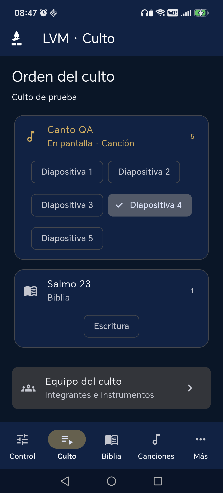
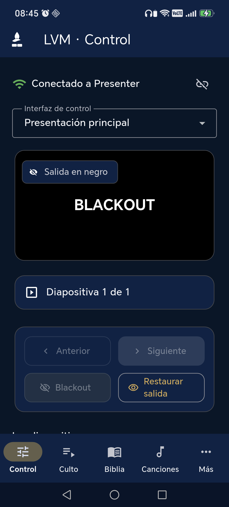
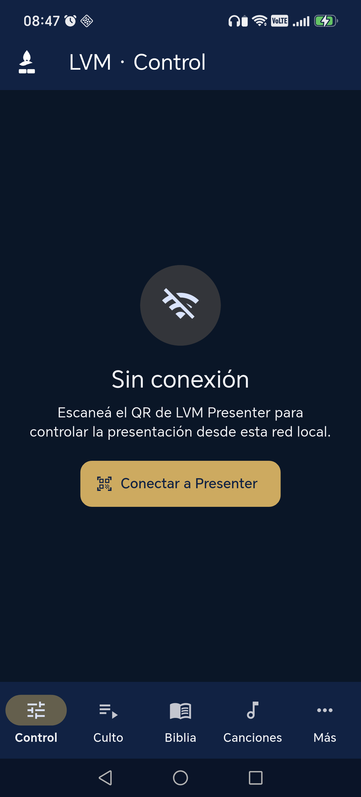

# M14E.3 — Prueba física de Remote, 24 de noviembre de 2026

## Candidatos y entorno

- Mobile: `57288cf0f03a6a962e2bb4b8a11c856c0c7393bd` (PR #17, sin modificar su HEAD).
- Presenter: `107d18ed8eb792c8fea6329044dd850ba3385609`, combinado en checkout QA con main `4b7436d5f64259c51bc0587327ea15a93a26f9d1`; árbol `372ccfd855c1918e7dec4afe617ccd1239a35443`.
- Dispositivo físico: HONOR ELP-NX9, Android 16 / SDK 36, arm64. El usuario autorizó expresamente este teléfono en lugar del Samsung A12.
- Presenter ejecutado con Electron real, perfil temporal y un culto QA con canción y escritura. Ningún dato institucional ni producción fueron modificados.
- ADB USB se usó para instalar y operar controles. Se verificó el WebSocket establecido entre las IP Wi-Fi del teléfono y la PC. El reverse USB preparado inicialmente se retiró antes de repetir el emparejamiento.

## APK y procedencia

El [build de QA 45385545262](https://github.com/MathiasFretes/lvm-mobile/actions/runs/45385545262) hizo checkout explícito del SHA de Mobile anterior, verificó HEAD y compiló con Flutter 3.47.7 / Java 17. Conserva APK, SOURCE.json y SHA256SUMS como artefacto de QA durante siete días; no es una distribución pública.

El workflow vive en la rama QA separada `qa/remote-device-57288cf`; su commit de receta es `9fc5b0a`. No se modificó el código candidato para generar el APK.

Android rechazó inicialmente la actualización por diferencias entre las claves debug de CI y la instalación anterior. Se refirmó localmente con la clave Android debug ya existente en la PC, cuya huella coincidió con la app instalada. Se comprobaron hashes idénticos de todas las entradas ZIP fuera de META-INF; no cambiaron código, recursos ni manifiesto. Se instaló mediante actualización, sin desinstalar ni borrar datos.

| Comprobación | SHA-256 |
| --- | --- |
| APK original de CI | `75d093d77b3381c5c2a327ea5138a91fe9ef95c5311efe13b34d77b76561920e` |
| APK refirmado e instalado, verificado en el teléfono | `44abd210864932dc7aaf728665fe043829a7fec675f00c0afc67eb35ce32ff69` |
| Certificado debug existente | `b51045f588af9c7ef1d51113a8ee6cc93809a2b9c7be8f23a98673173e1b0d27` |

[Manifiesto de instalación](remote-device-2026-11-24/installed-source.json).

## Resultados

| Escenario | Evidencia y resultado |
| --- | --- |
| QR y conexión | El usuario enfocó el código con la cámara real y confirmó la conexión; la UI instalada mostró Conectado a Presenter. El harness QA aprobó la solicitud mediante el gestor real de Presenter. |
| Siguiente | El teléfono avanzó desde la diapositiva 1 a la 2; el estado de Presenter reflejó el índice 1. |
| Orden del culto | La pantalla Culto recibió canción y escritura reales. Seleccionar Escritura cambió a Salmo 23; seleccionar Diapositiva 4 volvió a Canto QA, itemIndex 0 / slideIndex 3. |
| Anterior / siguiente | Desde la diapositiva 4, Anterior llevó al índice 2 y Siguiente devolvió el índice 3 en Presenter. |
| Blackout | El teléfono mostró salida en negro y Presenter mantuvo isCleared=true con la posición de Salmo 23. |
| Pérdida de conexión | Se reinició solo el transporte Remote. La app descartó el snapshot y mostró Sin conexión; Presenter conservó su posición y blackout. |
| Nuevo emparejamiento | El usuario escaneó el QR nuevo y confirmó la reconexión. El teléfono recuperó Salmo 23; Presenter siguió en blackout sin restauración automática. |
| Restauración | Solo pulsar Restaurar desde el teléfono devolvió isCleared=false. |
| Desconexión manual | Desconectar retiró los controles de la app y conservó la posición de Presenter. |
| Solicitud sin sesión | Una petición QA no autenticada a ese mismo servidor recibió command.rejected / unauthorized; el snapshot de Presenter quedó idéntico al anterior. |

Las [aserciones](remote-device-2026-11-24/assertions.json) y snapshots JSON se conservaron junto con las capturas. La lectura inicial de los XML desde Windows necesitó especificar UTF-8; corregida esa lectura, las verificaciones documentales pasaron sin repetir ni alterar el flujo ejecutado.

## Alcance y límites

La prueba física del cliente candidato quedó aprobada para este dispositivo y esta LAN. No es una certificación del Samsung A12, del instalador firmado, de una salida física NDI/proyector ni de todas las redes. La interrupción probada fue el reinicio del transporte, no el cambio físico de punto de acceso. La reconexión requiere QR y aprobación explícita; no se implementó reconexión automática. El clic de aprobación en la interfaz de escritorio no se certifica aquí: se usó el gestor real mediante el harness QA.

El gate físico no autoriza fusiones. Presenter #13 y Mobile #17 conservan sus HEAD, siguen en borrador y necesitan la decisión de integración coordinada. Mobile #11, la limpieza de ramas y producción son decisiones independientes. La rama QA de evidencia no debe fusionarse como cambio de producto ni eliminarse antes de conservar este informe.
